# TyControls

A custom-drawn component library for Lazarus. All 195 controls are rendered with BGRABitmap and styled by `.tycss` text themes, so your UI looks exactly the same on Windows, Linux, and macOS.

> **中文:** [README.md](README.md) · **Changelog:** [CHANGELOG.en.md](CHANGELOG.en.md)

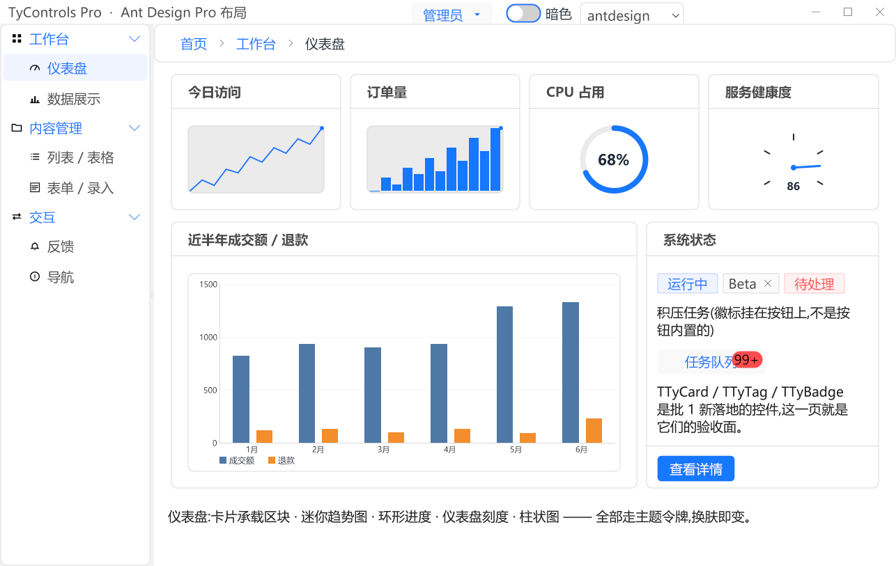

**Same program, different theme name:**

| `classic` | `win11` | `material3` |
|---|---|---|
| 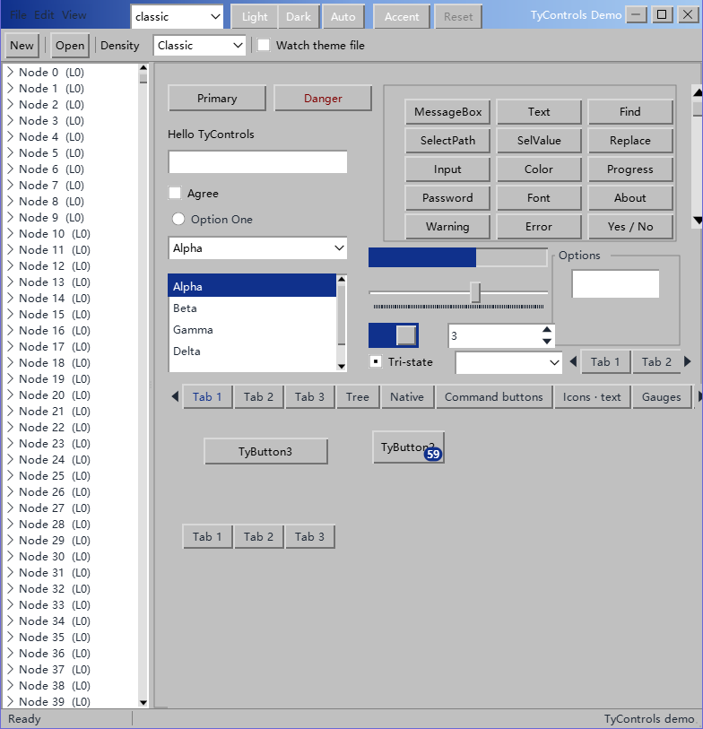 | 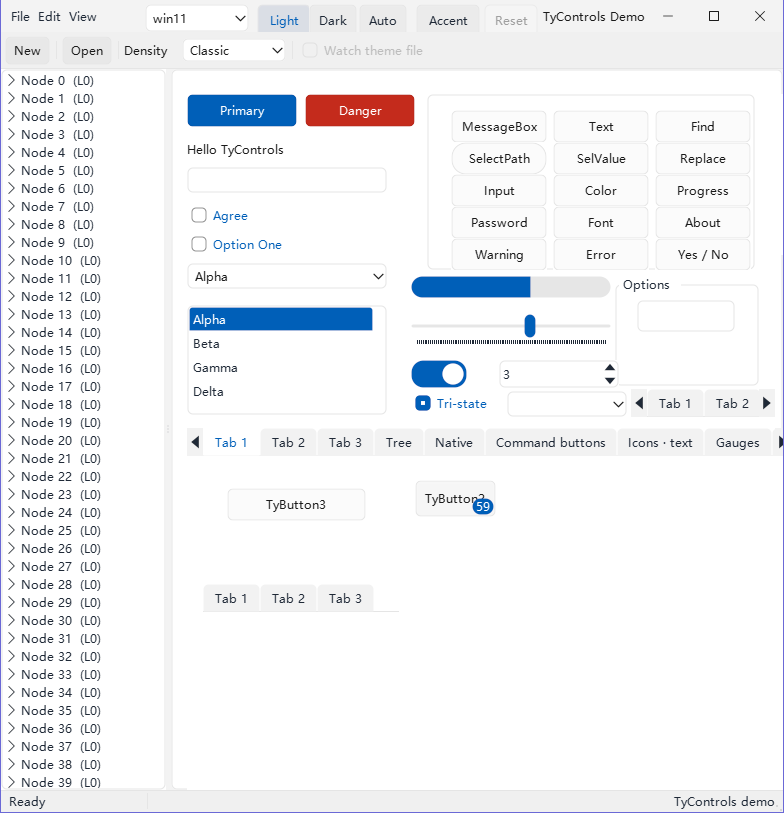 | 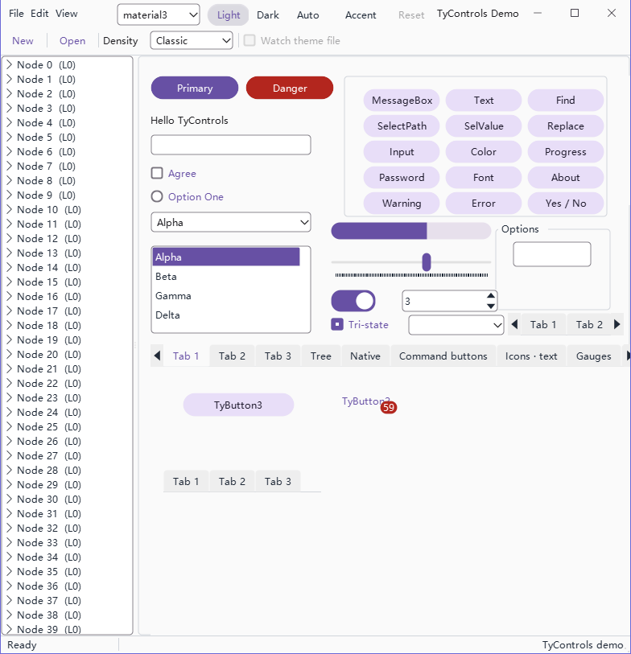 |

The three are one window and one code base; only the theme name differs. Themes go beyond colors: under `classic`, buttons get 3D bevels, square corners, and a gradient header band. Every built-in theme side by side: see the [gallery](docs/gallery.en.md).

### Light / dark / image themes

| Light | Dark | `green` (image theme) |
|---|---|---|
| 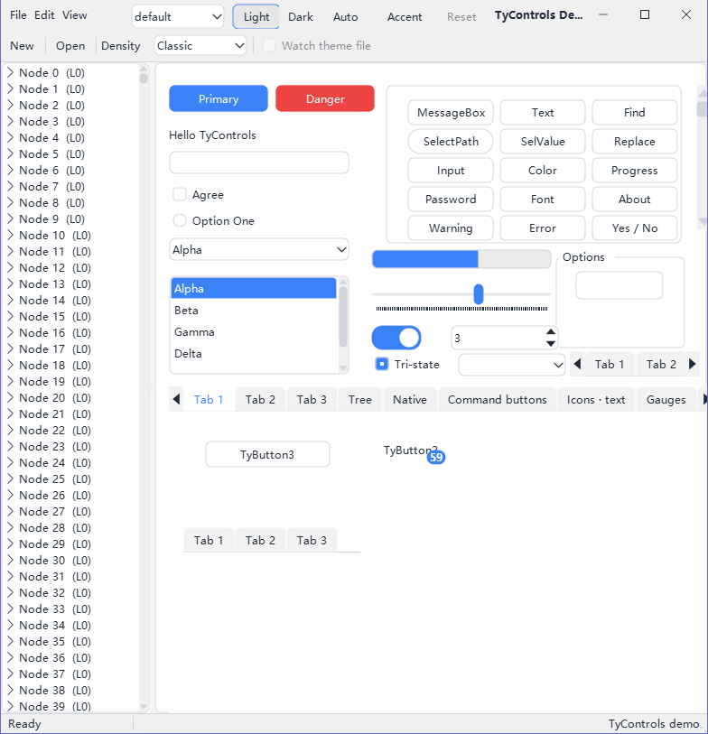 | 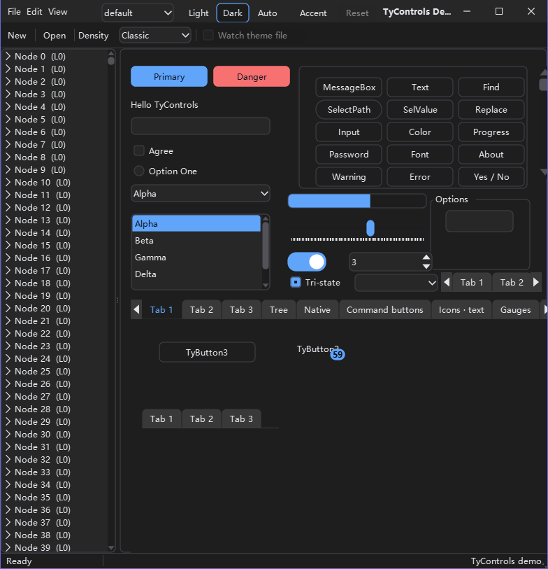 | 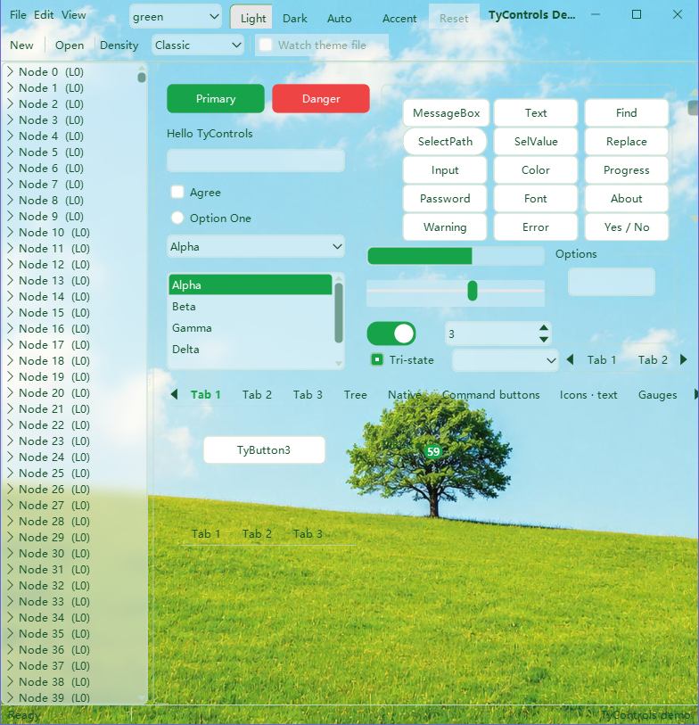 |

Light and dark are two `@mode` value sets in one theme file and can follow the OS. `green` is an image theme: translucent controls over a photo background.

### A few of the controls

| | |
|---|---|
| **`TTyStringGrid`** per-column editors: check box, rating, colour, button<br>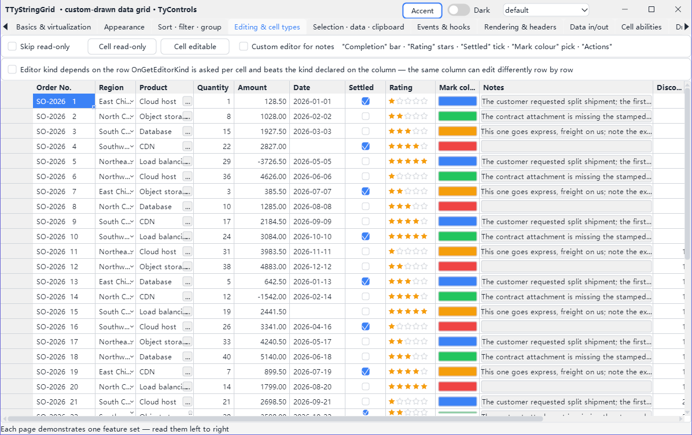 | **`TTyTreeView`** virtual tree, multi-column, tri-state checks<br>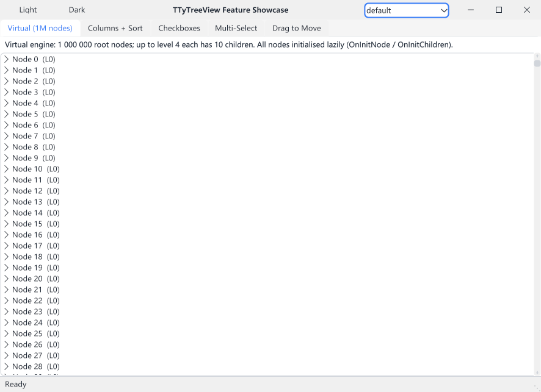 |
| **Rich input controls** numeric / currency / mask / slider / calculator<br>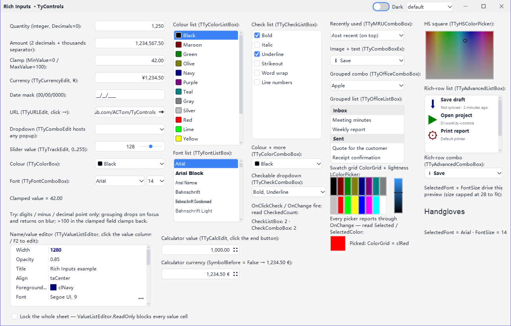 | **`TTyChart`** line, bar, pie, donut<br>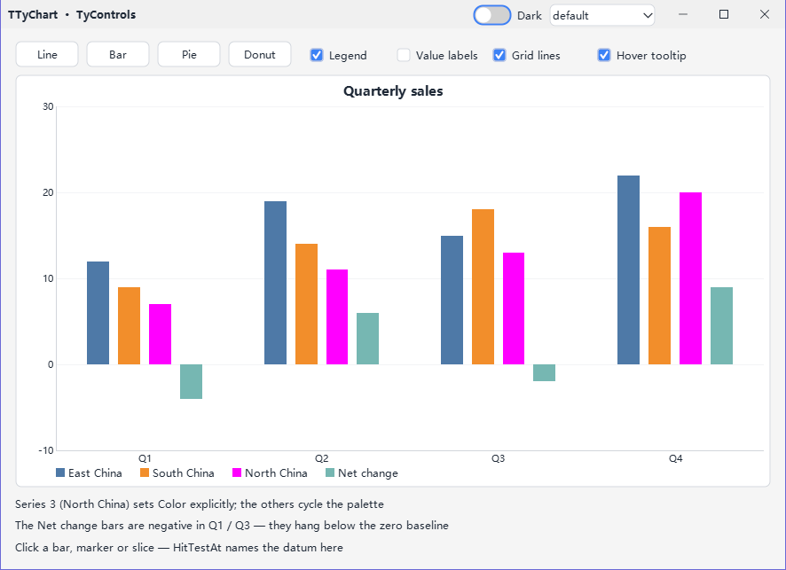 |
| **`TTyRibbon`** ribbon, quick access toolbar, Alt key tips<br>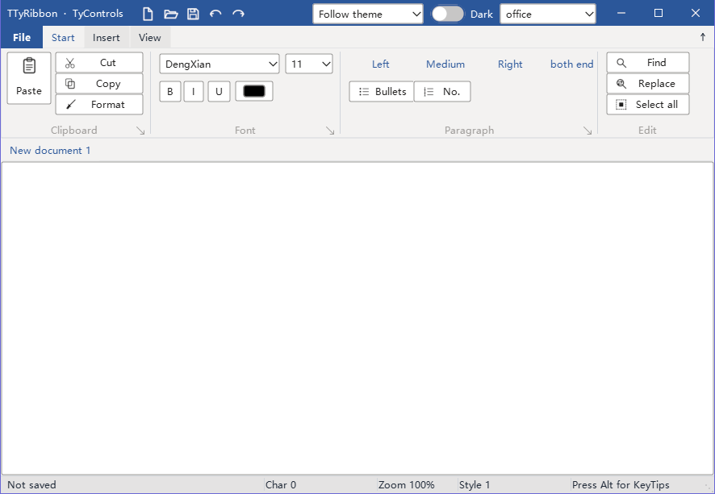 | **`TTyCalendar`** week numbers, today highlight, selectable range<br>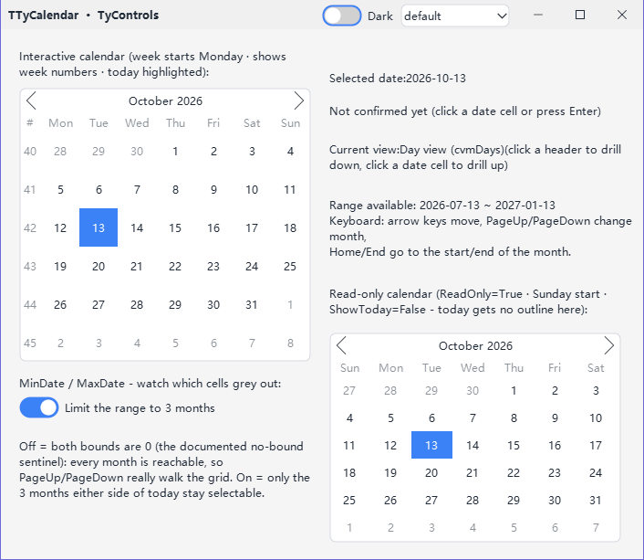 |

Every example, every tab page, in light and dark: see the [gallery](docs/gallery.en.md).

---

## Features

- **195 controls**: buttons, inputs, lists, data grid, virtual tree, Ribbon, calendar, shell file browsing, 20 custom-drawn dialogs and 22 data-aware controls
- **ECharts-style charts**: `TTyAdvanceChart` is configured with an Apache ECharts option, so the ECharts docs apply and options from its examples paste in unchanged; it draws line, bar, pie, scatter, radar, heatmap, tree, sunburst, Sankey and more, with axes and text that follow the theme
- **Data-aware controls**: a separate package, `tycontrols_db`, with 22 controls you bind to a `TDataSource` field; the data grid `TTyDBGrid` behaves like LCL's `TDBGrid`
- **Property grid**: `TTyPropertyGrid` lists any object's published properties at run time and writes edits straight back, with multiselect, a name filter and categories
- **Terminal**: `TTyTerminalView` parses output and encodes keys after xterm.js; in the example, hooked up to ConPTY / a PTY, it is a working shell window
- **Made to be subclassed**: most controls come in two layers, `TTyCustomXxx` (the implementation, nothing published) and `TTyXxx` (the one on the palette), so a wrapper shows only the properties you choose; a subclass keeps its parent's theme styling and can register a theme key of its own to be styled separately, see [subclassing.en.md](docs/subclassing.en.md)
- **Identical on all three platforms**: fully custom-drawn, no native control wrapping — one code base renders the same UI everywhere
- **Theming**: 17 built-in themes switched by a single property, with runtime hot-swap and OS light/dark and accent-color following; themes are text files, so restyling needs no recompile
- **Classic and modern looks**: from Win95 / XP bevels to Win11 / Material flat design, with a switchable control-density scale
- **HiDPI**: vector drawing stays crisp at any scale; DPI adapts automatically when dragging across monitors
- **Full designer support**: palette drag-and-drop, container controls you drop into directly, live theme preview at design time, File → New project templates
- **2,022 vector icons built in** (Lucide), referenced by name, zero cost if unused
- **English and Chinese UI**, gettext `.po` translations
- **10,000+ unit tests**, whole suite leak-free

## Supported platforms

| Platform | Widgetset |
|---|---|
| Windows | Win32 / Win64 |
| Linux | GTK2, Qt5, Qt6; GTK3 partially supported ([known issues](docs/known-issues.en.md) under Wayland) |
| macOS | Cocoa |

Requires Lazarus 3.0+, FPC 3.2.2+, and BGRABitmap (OPM package `BGRABitmapPack`).

---

## Quick start

**1. Install the package**

Open `tycontrols_dt.lpk` in Lazarus and click **Use → Install**; the IDE rebuilds and restarts. The runtime packages `tycontrols.lpk` and `tycontrols_db.lpk` (the data-aware controls) install automatically as dependencies.

**2. New project**

**File → New… → Project → TyControls Application**

The template creates a main form with a custom-drawn title bar, the content container `Surface`, and a style controller already wired up. Put your controls on `Surface` — a `TTyForm`'s visual controls all live there, and graphic controls must (see the [TTyForm docs](docs/controls/ttyform.md)). To add a form to an existing project, use **File → New… → Form → TyControls Form**.

**3. Switch themes**

Select the `TTyStyleController` on the form and set `ThemeName` to any built-in theme name. The designer updates immediately; change the same property at runtime to hot-swap. The template's `.lpr` already calls `TyRegisterBuiltinThemes` at startup; a project set up another way needs that line too, or a built-in theme picked by name shows only in the designer.

Full walkthrough: [docs/getting-started.en.md](docs/getting-started.en.md).

---

## Control list

195 controls across 17 palette pages. Per-control properties, events, and theme keys: **[docs/controls/](docs/controls/)**.

### Core · `TyControls` (2)

| Control | Description |
|---|---|
| `TTyStyleController` | Style controller: loads themes, switches density, follows OS light/dark |
| `TTyNativeStyler` | Themes native / third-party LCL controls to match |

### Buttons · `TyControls Buttons` (8)

| Control | Description |
|---|---|
| `TTyButton` | Button with primary / danger / ghost variants and a numeric badge |
| `TTyGlyphButton` | Button with an icon |
| `TTyGlyphContainerButton` | Square icon-only button, typical on toolbars |
| `TTySpeedButton` | Shortcut button that can stay pressed |
| `TTyDropDownButton` | Split button: left half acts, right half opens a menu |
| `TTyMenuButton` | The whole button is the dropdown trigger |
| `TTyColorButton` | Button that shows and picks a color |
| `TTyButtonGroup` | Segmented bar; adjacent segments share edges, one selected |

### Labels & marks · `TyControls Labels` (7)

| Control | Description |
|---|---|
| `TTyLabel` | Text label with word wrap (including per-glyph CJK breaking) and mnemonics |
| `TTyHtmlLabel` | Label supporting an inline HTML subset (bold / italic / link / color) |
| `TTyLinkLabel` | Hyperlink text |
| `TTyShadowLabel` | Label with a drop shadow |
| `TTyGlowLabel` | Label with a glow outline |
| `TTyTag` | Closable tag pill |
| `TTyBadge` | Numeric / dot badge that can attach to any control |

### Text & numeric input · `TyControls Edits` (15)

| Control | Description |
|---|---|
| `TTyEdit` | Single-line edit: selection, clipboard, word navigation |
| `TTyMemo` | Multi-line edit |
| `TTyTerminalView` | Terminal: draws a program's output and encodes keys for the host, after xterm.js; its own colour scheme if wanted (reads and writes Windows Terminal's format); hooks for in-band protocols and for the parser (ZModem send and receive in the example) |
| `TTySpinEdit` | Integer spinner |
| `TTyFloatSpinEdit` | Decimal spinner; the step can be less than 1 |
| `TTyNumericEdit` | Digits-only field, group-formatted on blur |
| `TTyCurrencyEdit` | Currency field |
| `TTyMaskEdit` | Masked input (phone, ID, date) |
| `TTyURLEdit` | URL field with a trailing open button |
| `TTyComboEdit` | Edit plus a dropdown arrow; you decide what drops down |
| `TTyTrackEdit` | Numeric field with an inline slider |
| `TTyCalcEdit` | Field with an inline calculator |
| `TTyCalcCurrencyEdit` | Currency calculator field |
| `TTyCalculator` | Standalone calculator panel |
| `TTyUpDown` | Standalone up/down spinner, bindable to another control |

### Choices & switches · `TyControls Choices` (6)

| Control | Description |
|---|---|
| `TTyCheckBox` | Check box, tri-state capable |
| `TTyRadioButton` | Radio button |
| `TTyToggleSwitch` | Toggle switch |
| `TTyRadioGroup` | Titled radio group |
| `TTyCheckGroup` | Titled check-box group |
| `TTySegmented` | Segmented control |

### Lists & dropdowns · `TyControls Lists` (15)

| Control | Description |
|---|---|
| `TTyComboBox` | Combo box, editable, with prefix autocomplete |
| `TTyListBox` | List box |
| `TTyCheckListBox` | List with a check box per row |
| `TTyMRUComboBox` | Combo box that remembers recent entries |
| `TTyComboBoxEx` | Combo box with a per-item image |
| `TTyOfficeComboBox` | Combo box with group headers |
| `TTyOfficeListBox` | List with group headers |
| `TTyAdvancedComboBox` | Two-line items (title + subtitle + image) |
| `TTyAdvancedListBox` | Rich two-line list |
| `TTyCheckComboBox` | Multi-select combo box |
| `TTyValueListEditor` | Name/value editor: key on the left, value on the right, editor kind per row |
| `TTyPropertyGrid` | Property grid: lists an object's published properties and writes edits straight back |
| `TTyTransfer` | Dual-list transfer |
| `TTyTreeSelect` | Selector whose dropdown is a tree |
| `TTyCascader` | Cascading multi-column selector |

### Color / font / file pickers · `TyControls Pickers` (11)

| Control | Description |
|---|---|
| `TTyColorBox` | Color dropdown |
| `TTyColorComboBox` | Color dropdown with a trailing More… entry opening the color dialog |
| `TTyColorListBox` | Color list |
| `TTyColorGrid` | Swatch grid palette |
| `TTyLColorPicker` | Lightness bar picker |
| `TTyHSColorPicker` | Hue / saturation picker |
| `TTyFontComboBox` | Font dropdown; each item previews in its own typeface |
| `TTyFontListBox` | Font list |
| `TTyFontSizeComboBox` | Font-size dropdown |
| `TTyFilterComboBox` | File-type filter dropdown |
| `TTyShellComboBox` | Directory dropdown |

### Gauges & indicators · `TyControls Gauges` (12)

| Control | Description |
|---|---|
| `TTyGauge` | Gauge: linear / arc / ring |
| `TTyMeter` | Needle gauge |
| `TTyLevelMeter` | VU meter with lit segments and peak hold |
| `TTyDial` | Rotary knob |
| `TTyGearDial` | Knob with a toothed rim |
| `TTyAnalogClock` | Analog clock |
| `TTyCircularProgress` | Ring progress |
| `TTyActivityIndicator` | Spinning busy ring |
| `TTyActivityBar` | Indeterminate progress bar |
| `TTyGearActivityIndicator` | Gear-shaped busy indicator |
| `TTySparkline` | Mini trend chart |
| `TTyRating` | Star rating |

### Bars · `TyControls Bars` (18)

| Control | Description |
|---|---|
| `TTyTrackBar` | Slider |
| `TTyRangeTrackBar` | Range slider: one or more draggable ranges on one track |
| `TTyMultiTrackBar` | Multi-value slider: each thumb with its own colour, hint and style; the stretches between them can be coloured |
| `TTyGradientTrackBar` | Gradient stop editor: the track shows the gradient; click to add a stop, drag one off to remove it, double-click to change its colour |
| `TTyProgressBar` | Progress bar |
| `TTyScrollBar` | Scroll bar; can fade out when idle, per theme or per control (`AutoHide`) |
| `TTyStatusBar` | Status bar |
| `TTyToolBar` | Toolbar |
| `TTyToolButton` | Toolbar button: six styles (command / toggle / dropdown / grouped / separator, …) |
| `TTyToolSeparator` | Toolbar separator |
| `TTyToolBarEx` | Toolbar that folds overflow into a menu |
| `TTyControlBar` | Container that wraps children into bands |
| `TTyCoolBar` | Draggable band container |
| `TTyAlert` | Inline alert: info / success / warning / error |
| `TTyPagination` | Pager |
| `TTySteps` | Step bar |
| `TTyBreadcrumb` | Breadcrumb trail |
| `TTyHeaderControl` | Standalone column header strip |

### Containers & layout · `TyControls Containers` (22)

| Control | Description |
|---|---|
| `TTyPanel` | Panel |
| `TTyGroupBox` | Group box |
| `TTyCard` | Card: title / content / actions |
| `TTyExPanel` | Collapsible panel |
| `TTyScrollBox` | Scrollable container |
| `TTyScrollPanel` | Container that auto-scrolls near its edges |
| `TTyGridPanel` | Designer grid container; drop controls straight into its cells |
| `TTyRelativePanel` | Layout by relative rules |
| `TTyPageControl` | Page container; drop controls straight onto its pages |
| `TTyTabSheet` | One page of a `TTyPageControl` |
| `TTyTabSet` | Pure tab strip, hosts no pages |
| `TTySplitter` | Splitter |
| `TTyBevel` | Decorative bevel |
| `TTyDivider` | Divider line, optionally captioned |
| `TTyPaintPanel` | Panel that hands you its canvas |
| `TTySizeBox` | Bottom-right size grip |
| `TTyToolGroupPanel` | Tool group container |
| `TTyListGroupPanel` | List container with group headers |
| `TTyTitleBar` | Custom-drawn title bar, pairs with `TTyForm` |
| `TTyEmpty` | Empty state: illustration + text + action button |
| `TTyToolWindowBar` | IDE-style side or bottom bar; tool windows move between sides and the layout can be saved |
| `TTyToolWindowManager` | Links the bars: dragging windows across, saving and restoring the layout |

### Data views · `TyControls Data Views` (10)

| Control | Description |
|---|---|
| `TTyStringGrid` | Data grid: freezing, virtualization, editing, filtering, grouping, undo/redo |
| `TTyDrawGrid` | Owner-drawn grid |
| `TTyTreeView` | Virtual tree, million-node capable; multi-column, tri-state checks, inline edit, drag-drop |
| `TTyListView` | List view: report / icon / tile and more, grouping, virtual mode |
| `TTyShellTreeView` | File-system directory tree |
| `TTyShellListView` | File-system file list |
| `TTyCalendar` | Calendar with day / month / year drill-down |
| `TTyDateTimePicker` | Date-time picker with null-date support |
| `TTyImageView` | Image viewer: pan, zoom, filters |
| `TTyPreviewBox` | File preview pane |

### Data-aware · `TyControls Data Controls` (22)

A separate package, `tycontrols_db`: bind a field of a `TDataSource` and go; the look follows the theme. See [docs/controls/dbcontrols.md](docs/controls/dbcontrols.md), and [docs/controls/dbgrid.md](docs/controls/dbgrid.md) for the grid (both in Chinese).

| Control | Description |
|---|---|
| `TTyDBNavigator` | Record navigator: first / prior / next / last, insert, delete, edit, post, cancel, refresh |
| `TTyDBText` | Label showing a field's value |
| `TTyDBEdit` | Single-line edit bound to a field |
| `TTyDBMaskEdit` | Masked edit; takes the field's `EditMask` by default |
| `TTyDBNumericEdit` | Number edit that reads and writes the field as a number |
| `TTyDBCurrencyEdit` | Currency edit that reads and writes the field as a number |
| `TTyDBSpinEdit` | Integer spin edit |
| `TTyDBFloatSpinEdit` | Decimal spin edit |
| `TTyDBMemo` | Multi-line edit bound to a memo field |
| `TTyDBCheckBox` | Check box; `ValueChecked` / `ValueUnchecked` map the field, NULL shows grayed |
| `TTyDBToggleSwitch` | Switch, mapped like the check box |
| `TTyDBRadioGroup` | Radio group; `Values` map the field |
| `TTyDBSegmented` | Segmented control; `Values` map the field |
| `TTyDBRating` | Star rating bound to a number field |
| `TTyDBComboBox` | Combo box: pick or type the field's value |
| `TTyDBLookupComboBox` | Lookup combo: lists another table's rows, writes the key |
| `TTyDBListBox` | List box; the selected item is the field's value |
| `TTyDBLookupListBox` | Lookup list |
| `TTyDBImage` | Picture bound to a blob field; reads and writes LCL `TDBImage`'s format |
| `TTyDBDateTimePicker` | Date-time picker with null-date support |
| `TTyDBCalendar` | Calendar whose picked day is written back to the field |
| `TTyDBGrid` | Data grid: a row per record, in-place editing, insert, delete, multiselect; behaves like LCL's `TDBGrid` |

### Menus · `TyControls Menus` (4)

| Control | Description |
|---|---|
| `TTyMenuBar` | Main menu bar |
| `TTyPopupMenu` | Context menu |
| `TTyImagesMenu` | Context menu with an icon column fed by an image list |
| `TTyMenuEx` | Enhanced context menu: section headers and a side banner on top of the icon column |

### Ribbon · `TyControls Ribbon` (7)

| Control | Description |
|---|---|
| `TTyRibbon` | The ribbon itself |
| `TTyRibbonPage` | Ribbon page |
| `TTyRibbonGroup` | Group within a page |
| `TTyRibbonAppMenu` | Application (File) button |
| `TTyRibbonQuickAccess` | Quick access toolbar |
| `TTyRibbonGallery` | Gallery that expands into a popup grid |
| `TTyRibbonBackstage` | Full-window backstage view |

### Images & hints · `TyControls Images` (11)

| Control | Description |
|---|---|
| `TTyIconFont` | Icon font: vector icons by codepoint or name, themed |
| `TTyLucideIconFont` | The bundled Lucide icon font, ready to use |
| `TTyCharImage` | Uses one icon-font glyph as an image |
| `TTyImage` | Image control |
| `TTyGlyphImageList` | Image list driven by an icon font |
| `TTyImageCollection` | Multi-resolution image set, picked per DPI |
| `TTyLucideImageList` | Image list of the bundled Lucide icons, picked by name |
| `TTyVirtualImageList` | Renders any size on demand; it is a standard `TCustomImageList`, assignable to any control, addressable by image name |
| `TTyHint` | Themed tooltip |
| `TTyBalloonHint` | Balloon tooltip with a pointer |
| `TTyPopover` | Popover that hosts controls |

**Built-in icons (Lucide)**: one `uses tyControls.Icons.Lucide` gives you 2,022 vector icons, referenced by name:

```pascal
CharImage1.IconFont  := TyLucideFont;
CharImage1.GlyphName := 'house';
```

The font is embedded in the unit — nothing to ship or install, and it costs nothing if you don't use it. `TTyLucideImageList` on the palette works as a drop-in image list. Licensed ISC / MIT with no attribution required at runtime; just ship [THIRD-PARTY-NOTICES.md](THIRD-PARTY-NOTICES.md) with your release.

### Shapes & charts · `TyControls Shapes & Charts` (5)

| Control | Description |
|---|---|
| `TTyShape` | Vector shape: 15 kinds (rectangle / circle / triangle / diamond / star, …) plus custom polygons |
| `TTyStarShape` | Star with a configurable point count |
| `TTyArrow` | Directional arrow |
| `TTyChart` | Chart: line / bar / pie |
| `TTyAdvanceChart` | Advanced chart configured by an Apache ECharts option, with dataZoom, visualMap, tooltips and a toolbox |

### Dialogs · `TyControls Dialogs` (20)

| Control | Description |
|---|---|
| `TTyMessage` | Message box |
| `TTyInputDialog` | Text input dialog |
| `TTyPasswordDialog` | Password dialog |
| `TTyTextDialog` | Multi-line text dialog |
| `TTySelectValueDialog` | Pick-from-a-list dialog |
| `TTySelectPathDialog` | Folder picker |
| `TTyColorDialog` | Color picker: HSV / RGB / CMYK / alpha |
| `TTyFontDialog` | Font dialog with live preview |
| `TTyFindDialog` | Find dialog |
| `TTyReplaceDialog` | Find-and-replace dialog |
| `TTyProgressDialog` | Progress dialog |
| `TTyAboutDialog` | About box |
| `TTyOpenDialog` | Open-file dialog |
| `TTySaveDialog` | Save-file dialog |
| `TTyOpenPictureDialog` | Open-picture dialog with thumbnails |
| `TTySavePictureDialog` | Save-picture dialog |
| `TTyOpenPreviewDialog` | Open dialog with a custom preview pane |
| `TTySavePreviewDialog` | Save dialog with a custom preview pane |
| `TTyNotification` | Corner toast |
| `TTyIconBrowserDialog` | Icon browser |

The bigger controls have docs of their own (in Chinese): [grid.md](docs/controls/grid.md) (`TTyStringGrid`) · [treeview.md](docs/controls/treeview.md) (`TTyTreeView`) · [ttyform.md](docs/controls/ttyform.md) (`TTyForm`) · [dbgrid.md](docs/controls/dbgrid.md) (`TTyDBGrid`) · [propertygrid.md](docs/controls/propertygrid.md) (`TTyPropertyGrid`) · [terminal.md](docs/controls/terminal.md) (`TTyTerminalView`) · [multitrackbar.md](docs/controls/multitrackbar.md) (the multi-thumb track bars).

---

## Themes

Built-in themes are compiled into the binary, so apps switch by name without shipping a `themes/` folder:

| Theme | Description |
|---|---|
| `default` | Neutral base, light and dark in one file |
| `system` | Follows the OS light/dark and accent color |
| `win11` `win10` `xp` `classic` `aero` | Windows generations |
| `macos` `adwaita` `breeze` `ubuntu` | macOS and Linux desktops |
| `material3` `fluent` `antdesign` `bootstrap` | Common design systems |
| `office` | Office style |
| `showcase` | Showcase theme |

Also the image theme `green` (shipped as a file) and curated palettes under `themes/palettes/`. All themes share one set of semantic variables, and `--accent` can be overridden at runtime with any brand color.

Writing your own theme: [docs/themes.en.md](docs/themes.en.md). The `.tycss` language reference: [docs/tycss-reference.en.md](docs/tycss-reference.en.md).

The repository also has a theme editor, `tools/themebuilder`: the preview follows as you type, and a language model can draft or change a theme from a sentence. See [docs/themebuilder.en.md](docs/themebuilder.en.md).

---

## Examples

52 examples, each of which builds on its own: `lazbuild examples/<name>/<project>.lpi`. They show English or Chinese text to match the OS, and every one has a theme picker and a dark switch in its title bar.

**Showcases**

| Example | Contents |
|---|---|
| [advchart](examples/advchart/) | Advanced chart: the 244 options of the Apache ECharts example gallery, loaded as they are and sorted into the gallery's categories; edit an option on the right and it redraws, and anything it cannot draw yet is listed with the reason; save as PNG |
| [antdesign](examples/antdesign/) | Ant Design Pro-style admin (sider + 6 pages), runtime theming |
| [dbcontrols](examples/dbcontrols/) | Data-aware controls: 21 of them bound to an in-memory table; navigating, editing, NULLs, lookups, photos |
| [dbgrid](examples/dbgrid/) | Data grid: a thousand orders, design-time columns (check box, lookup, memo, formatted amount), sorting by title click, deleting a multiselection, a read-only switch |
| [demo](examples/demo/) | Overview: fifty-odd everyday controls in one window; the toolbar switches theme, light/dark, accent colour and density, and can watch the theme file for changes |
| [dialogs](examples/dialogs/) | All the custom-drawn dialogs: message, input, colour, font, find and replace, progress, about, icon browser and more |
| [grid](examples/grid/) | Data grid: freezing / million rows / sort-filter-group / 15 editors / undo-redo |
| [listview](examples/listview/) | List view: five views / grouping / 100k rows in virtual mode |
| [propertygrid](examples/propertygrid/) | Property grid: click a control to inspect it (Ctrl+click for several) and edit it in place; a name filter, categories, writable-only and show-events switches, adding and deleting a string grid's columns |
| [ribbon](examples/ribbon/) | A text editor built on the Ribbon: tabs, the application menu, the quick access toolbar, a contextual tab, Alt key tips |
| [rtl](examples/rtl/) | Right-to-left mirroring and bidirectional text |
| [terminal](examples/terminal/) | Terminal: asciicast replay, a real shell (ConPTY / PTY / pipes), ZModem send and receive, skins, colour schemes, a key-code panel |
| [theming](examples/theming/) | The theme system: a custom theme file, accent colour, following the OS, density, hot reload, an overlay style layer |
| [toolwindows](examples/toolwindows/) | IDE-style workbench: side bars and a bottom panel, drag windows across, save and restore the layout |
| [transitions](examples/transitions/) | Slide / fade transitions |
| [treeview](examples/treeview/) | Virtual tree: million nodes / multi-column / checks / inline edit / drag-drop |

**Single controls**

| Example | Contents |
|---|---|
| [button](examples/button/) | `TTyButton`: primary / danger / ghost variants, default and cancel keys, a numeric badge, AutoSize |
| [buttons](examples/buttons/) | The other buttons: icon buttons, group toggles, split and menu buttons, the colour button, the segmented bar |
| [calendar](examples/calendar/) | `TTyCalendar`: week numbers, read-only, a selectable date range |
| [chart](examples/chart/) | `TTyChart`: line, bar, pie, donut; legend, value labels, hover tooltip, click hit-testing |
| [checkbox](examples/checkbox/) | `TTyCheckBox`: tri-state, disabled, `OnClick` versus `OnChange`, mnemonics |
| [combobox](examples/combobox/) | `TTyComboBox`: read-only list, editable with prefix autocomplete, opening and closing from code |
| [containers](examples/containers/) | Layout containers: dividers, bevels, paint panel, group containers, scrolling and collapsible panels, grid panel, relative layout, cool bar and more |
| [datetimepicker](examples/datetimepicker/) | `TTyDateTimePicker`: date, time, nullable, read-only, limited range, 12-hour clock, OS date format |
| [edit](examples/edit/) | `TTyEdit`: text hint, password, case and length limits, digits only, alignment, undo/redo, clipboard, selection API |
| [filedialog](examples/filedialog/) | The six file dialogs: plain, with picture preview, with a custom preview |
| [gauge](examples/gauge/) | The gauge family: arc / ring / linear gauges, needle meter, level meter, knobs, clock, sparkline, rating, busy indicators |
| [groupbox](examples/groupbox/) | `TTyGroupBox`: caption alignment, the untitled style, mnemonics |
| [hint](examples/hint/) | Themed and balloon hints: four icons, fading out, a sticky popover, flipping at the screen edge |
| [htmllabel](examples/htmllabel/) | `TTyHtmlLabel`: inline markup and links, word wrap, AutoSize |
| [icons](examples/icons/) | Icons and images: icon fonts, the bundled Lucide icons, image lists, `TTyImage` scaling modes |
| [imageview](examples/imageview/) | `TTyImageView`: pan and zoom, fit to window, non-destructive filters |
| [inputs](examples/inputs/) | Rich inputs: numeric, currency, masked, URL, slider field, colour and font pickers, assorted dropdowns and lists, a value list editor |
| [label](examples/label/) | `TTyLabel`: alignment, transparency, AutoSize, word wrap, vertical layout, mnemonics |
| [labels](examples/labels/) | Link, shadow and glow labels |
| [listbox](examples/listbox/) | `TTyListBox`: multiselect, sorting, row height, selecting and scrolling from code |
| [memo](examples/memo/) | `TTyMemo`: word wrap, read-only, undo/redo, clipboard, Tab and Enter handling, a length cap, scroll bars |
| [menu](examples/menu/) | Menu bar, enhanced context menu, plain themed menu, and rolling the window up by double-clicking the title bar |
| [panel](examples/panel/) | `TTyPanel`: nesting, caption alignment, `StyleOverride`, hints and clicks |
| [progressbar](examples/progressbar/) | `TTyProgressBar`: animation, vertical, any range, click to seek, disabled |
| [radiobutton](examples/radiobutton/) | `TTyRadioButton`: grouping, `GroupIndex`, mnemonics, `StyleOverride` |
| [scrollbar](examples/scrollbar/) | `TTyScrollBar`: every scrolling gesture, `OnScroll` overruling the target, thumb animation, fading out when idle |
| [shapes](examples/shapes/) | Shape controls + `StyleOverride` |
| [shell](examples/shell/) | A file browser: directory tree, file list, look-in dropdown, file-type filter |
| [spinedit](examples/spinedit/) | Integer and decimal spin edits: range, step, alignment, read-only, what happens out of range |
| [splitter](examples/splitter/) | `TTySplitter`: splits in four directions, capping a pane's size, resizing only on mouse-up |
| [statusbar](examples/statusbar/) | `TTyStatusBar`: several panels, size grip, simple mode, adding and removing panels at run time |
| [tabcontrol](examples/tabcontrol/) | `TTyPageControl`: adding and removing pages, close buttons, hiding the tab strip |
| [tabset](examples/tabset/) | `TTyTabSet`: drag to reorder, closing, a tab that refuses selection, overflow scrolling, mnemonics |
| [toggleswitch](examples/toggleswitch/) | `TTyToggleSwitch`: disabled, `OnChange` versus `OnClick`, no animation, keyboard use |
| [toolbar](examples/toolbar/) | `TTyToolBar`: wrapping, flat and framed, the six tool button styles, dropdown menus, owner-drawn buttons |
| [trackbar](examples/trackbar/) | Sliders: ticks, value display and keyboard use on the single slider, then the range slider, multi-value slider and gradient stop editor |

---

## Documentation

| Doc | Contents |
|---|---|
| [getting-started.en.md](docs/getting-started.en.md) | Install, first form, themes, HiDPI |
| [controls/](docs/controls/) | Per-control API reference (Chinese) |
| [themes.en.md](docs/themes.en.md) | Built-in themes and writing your own |
| [tycss-reference.en.md](docs/tycss-reference.en.md) | The `.tycss` language reference |
| [themebuilder.en.md](docs/themebuilder.en.md) | Using the theme editor |
| [events.en.md](docs/events.en.md) | Common event conventions |
| [subclassing.en.md](docs/subclassing.en.md) | Deriving your own controls from `TTyCustomXxx`; upgrading from 3.0 |
| [rtl.md](docs/rtl.md) | Bidirectional text and right-to-left layout (Chinese) |
| [known-issues.en.md](docs/known-issues.en.md) | Known issues |
| [CHANGELOG.en.md](CHANGELOG.en.md) | Changelog |
| [CONTRIBUTING.en.md](CONTRIBUTING.en.md) | Bug reports, feature requests, pull requests, roadmap |

---

## UI language

The library ships with English and Chinese UI strings. LCL's `SetDefaultLang` only loads your app's `.po`, so add one line for the library:

```pascal
uses ..., LCLTranslator;

SetDefaultLang('', LangDir);                                                        // your app
TranslateUnitResourceStringsEx('', LangDir, 'tycontrols', 'tyControls.StrConsts');  // the library
```

Deploy `languages/tycontrols.<lang>.po` next to your own `.po` files. A few notes:

- The deployed file name is `tycontrols.<lang>.po`, renamed from the source's `tycontrols.strconsts.<lang>.po`. The third argument must be `'tycontrols'` (no dot — LCL strips everything after a dot as an extension); the real unit name `tyControls.StrConsts` goes in the fourth.
- English deployments should ship `tycontrols.en.po` too; it is the switch that makes the calendar's and date picker's month and weekday names follow the app language.
- If you use the data-aware controls (`tycontrols_db`), add `TranslateUnitResourceStringsEx('', LangDir, 'tycontrols_db', 'tyControls.DB.StrConsts')` and deploy `tycontrols.db.strconsts.<lang>.po` renamed to `tycontrols_db.<lang>.po`.

Full example: [examples/demo](examples/demo/).

---

## License

Modified LGPL, the same license as the FPC RTL, LCL, and BGRABitmap: you may statically link the library into closed-source commercial applications; modifications to the library's own source must be released under the same license.

Full terms: [COPYING.modifiedLGPL.txt](COPYING.modifiedLGPL.txt) and [COPYING.LGPL.txt](COPYING.LGPL.txt).
